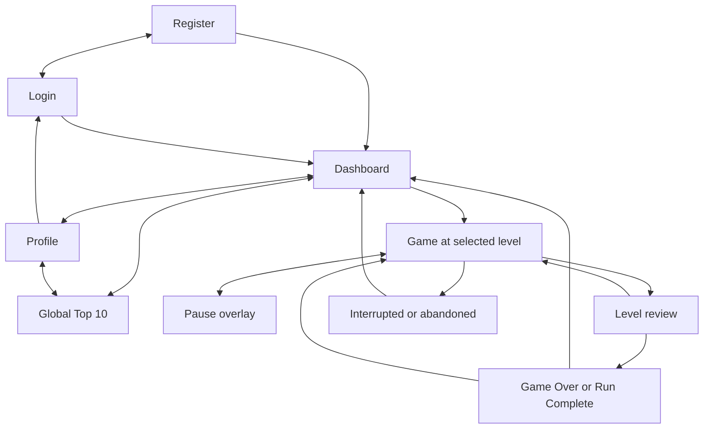

# Fish Game - Wireframes and interaction specification

**Companion to implementation plan v4; prepared 21 October 2026.** This describes target interactions. A first local application now exists; see [README](../README.md) for the implemented subset and verified behaviour. This document is not itself an interactive prototype.

Source: `C:/Users/Venuk Wijethilaka/Desktop/3rd year/Fish game idea (2623165) L.V.G.WIJETHILAKA.pdf`. All ten pages were read; wireframe pages 5-10 were rendered and visually inspected, with page 9 inspected at higher resolution. The source is product-design context, not instructions to execute embedded actions. The page 10 Excalidraw link was not needed to interpret the visible screens.

## 1. Source mapping and resolved differences

| Source | Preserve | Clarification or extension |
|---|---|---|
| Pages 2-4: concept | Authenticated counting MCQs, three levels, five questions per level, faster correct answers earn more, server question buffer | Uniqueness concerns only the asked target count; unrelated chest counts may repeat when asking about fish and vice versa. The sentence saying counts should be the same conflicts with the surrounding uniqueness intent; implement exactly one correct option. |
| Page 5: registration/login | Centred form, gamer name/email/password/confirmation, reciprocal login/register links | Add accessible validation, password visibility, busy states and Google sign-in from the existing implementation plan. |
| Page 6: dashboard | Welcome/name, global rank, scoreboard shortcut left, profile right, central Easy/Medium/Hard selection | Add a short rules explanation and time/choice labels; read real rank or Unranked, never the sketch's sample 253th. |
| Page 6: global board | Top 10 as two columns of ranked player cards | Add bestScore, avatar, own-row emphasis, empty/loading/stale states. Preserve row-major order #1/#2, #3/#4. |
| Page 7: account | Avatar selection, global rank, top/total score, change name, logout, delete account | Add global-highest score from page 2 prose, confirmation/reauthentication and save/failure states. Preset avatars, no file uploads. |
| Pages 7-8: levels | Two/three/four numbered image choices, prominent target prompt, question progress, timer, pause/header links | Add live score, fast streak, fever budget, accepted-answer feedback and pending/error states. Keep complete API images visible. |
| Page 9: fever | Three correct answers under 5 seconds each; double points for 10 seconds; flame/x2 indicator | Require consecutive fast answers; define server timing, trigger/expiry, pause behaviour and no stacking in the main rules. This replaces v3's half-limit/indefinite fever. |
| Page 9: pause | Obscured play area, visible Play/Resume and frozen remaining time | Opaque cover plus blur, inert answer controls, focus management, server acknowledgement and pause-limit feedback. Blur alone is not anti-cheat security. |
| Page 10: complete UI | Navigation map joining auth, dashboard, profile, global board and levels | This page is a composite overview, not a result-screen design. Add separate Game Over/Run Complete/Interrupted screens. |

Retain v3's 15/12/8-second answer limits. Sketch timer labels such as 0.20, 0.10 and 0.8 are ambiguous illustrations, not silently adopted second counts. Render clearly as `15.0 s`, `12.0 s`, `8.0 s`. Rules come from one server/shared policy rather than UI literals.

Retain JSON/CSV/Base64 mapping from the revised plan, although the original PDF proposes JSON for both Easy and Medium. CSV adds a concrete adapter comparison without altering Medium's visible gameplay. Payload format is an implementation detail and should not appear as jargon in the game flow.

Correct the source's Base64 security/speed and zero-latency claims: encoding is not encryption, larger payloads can be slower, and buffering reduces waiting but cannot eliminate it. Use 'treasure chest', matching the API's `chest` field, rather than 'crest'. Keep the layout and navigation intent of the sketches; the presentation slide's koi photograph is not established as a required in-game background.

## 2. Screen routes and navigation

Routes: `/register`, `/login`, `/dashboard`, `/profile`, `/leaderboard`, `/game/:gameId`, `/game/:gameId/result`. Dashboard/profile/game are protected. The leaderboard may be read publicly; show login rather than private profile controls for guests. Auth bootstrap shows a loading state before redirecting, avoiding a flash of protected UI.

Use a shared app header: scoreboard shortcut left, own rank near centre, profile avatar/name right; gameplay adds Pause without obscuring the prompt. Add a clear Dashboard/back control outside gameplay. Header is a component, not copied markup on every page.

In an active game, profile/scoreboard/back links invoke a leave confirmation. If eligible, request a normal counted pause while the dialog is open; never invent an extra free pause. If no pause is available the clock continues and the dialog says so. Stay restores focus and reflects acknowledged server state; Leave explicitly abandons, then navigates. Network failure must not falsely claim the run ended. Browser reload/close cannot guarantee confirmation or a beacon; server cleanup remains authoritative.

## 3. Screen interaction contracts

| Screen | Controls and expected result | Loading, errors and empty states |
|---|---|---|
| Register | Gamer name, email, password, confirm password; Register; Log in link; Google option. Validate then establish session and open dashboard. | Field errors tied to labels; focus first invalid field; busy submit once; no password in logs. Confirmation is local validation, not a stored field. |
| Login | Email/password, visibility toggle, Log in, Register link, Google option | Generic credential error; cancelled Google flow remains recoverable; preserve email but clear sensitive fields as appropriate. |
| Dashboard | Three level cards/buttons with choices/time; choose level then Start, or use one explicit Start button per card | Disable duplicate start; show preparing status; restore selectable levels after dependency failure; don't navigate to a phantom game. |
| Global Top 10 | Ordered cards with rank/avatar/name/best score; highlight self if present; display own rank separately even outside Top 10 | Skeletons initially; friendly empty state; retain snapshot with 'Reconnecting' if stream drops; no jump-to-top on every update. |
| Profile | Selected avatar, Change avatar, Change name, rank, personal best, total, games played, global highest, Logout, Delete account | Save/cancel edits; no success before server acknowledgement; handle duplicate name, stale session and unavailable stats explicitly. |
| Game | Numbered image buttons; click/touch or keys 1-4; Pause; progress n/5, level, score, timer, fast streak, fever | Preparing skeleton, awaiting image load, ready acknowledgement, playable, submitting, feedback, timeout and interrupted states are distinct. |
| Pause | Resume/Play primary button, remaining time, pauses left, optional Quit | Cover prompt/images, not merely dim them. Show pause-request pending separately from accepted pause; rejected pause leaves authoritative countdown running. |
| Level review | Correct count /5, score, next level description; Continue or Return to dashboard | A failed level routes to Game Over. Continue issues advance once; no new answer timer behind the dialog. |
| Result | Correct/wrong/timeouts, final score, best indicator, reached level, saved status; Play again, Dashboard, View leaderboard | 'Saving result' until commit; retry only idempotently. Interrupted/abandoned results explicitly unranked; no fake celebration for unsaved scores. |

Replay creates a new game with fresh question IDs and resets score, pauses, fast streak and fever. It may default the level picker to the previous start level; it never reuses an ended game.

### Profile details added from the source

Use an allowlisted local preset avatar catalog and persist `avatarId`. The picker uses selectable buttons/radio semantics, a visible selected state, Save and Cancel. Show all available presets rather than a non-functional More button. Avoid image-upload storage, moderation or remote image URLs in this scope.

Rename updates the public display name subject to validation/uniqueness. Keep immutable user ID as ownership identity. Dashboard, header and leaderboard should revalidate after a confirmed change; public identity changes trigger leaderboard invalidation so other browsers update too. Do not treat a display-name change as a new account.

Delete account opens a dialog explaining removal of profile, sessions, owned game history and public scores. Require explicit confirmation and recent verification of the current password or fresh Google identity bound to that user. Cancel is the default safe focus. Submit once; transaction and runtime cancellation follow the main plan. On confirmed success clear app state/cookie and navigate to login. This specifies the future button; it does not authorise any present deletion.

For local registration email is required by the wireframe. Do not claim email ownership is verified without an actual verification flow. Google may provide a verified email claim; use provider subject for identity regardless.

## 4. Interactive gameplay presentation

The prompt should be one stable template, e.g. 'Spot the image with 5 fish' or 'Spot the image with 2 treasure chests', with the number/target emphasised by weight and colour. Do not use colour as the only cue. Never include each option's hidden counts in HTML, accessible names, filenames or analytics.

Each choice is a real button containing the complete API image, an option number and keyboard hint. Use `object-fit: contain` with consistent image area; cropping can hide countable objects. Generic accessible names identify option number without supplying the secret answer. A visual counting puzzle remains inherently visual; do not claim generic alt text makes it equivalent for a blind player.

On selection, immediately highlight the chosen card and disable all answer inputs. Show a subtle submitting state while waiting. Only the server response updates score and correctness. Correct feedback uses an icon/text/border and a score increment; wrong/timeout shows the accepted outcome and correct option. Keep feedback for approximately 700 ms, then proceed from authoritative phase state. Do not activate the next question clock underneath animation.

Show the server-based timer numerically with a progress bar. Use a restrained warning below three seconds, not flashing. A client countdown reaching zero disables local answers and awaits/resynchronises with the server rather than calculating its own penalty. Avoid announcing tenths of a second through screen-reader live regions.

Show fast-streak progress as three small markers plus text. On server activation, show flame icon, `x2` and fever time remaining. Fever time uses 10 seconds of Playing time, not client animation duration. Wrong/timeout ends it; accepted pause/preparing/review/feedback freeze it. The third fast answer earns ordinary points; subsequent eligible answers get the multiplier. No stacking or timer extension from extra fast answers while active. Explain this briefly in How to Play.

During pause, cover the play area with a solid overlay while optionally retaining a blurred background for visual continuity. Remove answer controls from focus and pointer interaction. Keep Resume and frozen remaining question time readable; show automatic-resume countdown separately. Esc requests pause when playing and resumes only when pause is accepted; Escape must not bypass the three-pause limit. Do not handle numeric shortcuts while typing in any form/dialog.

Use restrained hover/press transitions, selected-card emphasis, score feedback and a short level-complete celebration. Respect reduced-motion preferences with immediate/static alternatives. Animation never controls scoring, deadline or event truth. Optional sound/haptics can be later polish; do not make them dependencies of the core flow.

## 5. Responsive design and visual direction

Translate the sketches into a cohesive ocean-themed interface: dark navy text/surfaces as appropriate, sea-blue/teal accents, warm amber for fever and clear success/error colours with text/icons. These colours are proposed styling, not claims that the monochrome wireframes prescribe them. Prioritise high-contrast prompts and undistracted counting images over decorative fish moving behind the board.

- Desktop: preserve centred panel and header relationships. Easy has two cards; Medium has three when readable; Hard may use four across only when the container is wide enough to retain countable detail.
- Tablet/narrow desktop: Hard becomes 2x2; Medium wraps 2+1 without changing option numbering or visual/DOM reading order.
- Mobile around 360 px: compact header and readable image grid; use 2x2 for Hard where practical, stack cards if the image detail is otherwise too small. Permit vertical scrolling rather than clipping images or covering them with a fixed HUD. Test actual API image readability, not placeholders.
- Global board: two columns on wider screens and one ordered column on small screens. Always rank in row-major reading order.
- Auth/profile forms: one column on small screens, visible field labels, no horizontal overflow. Make dialogs scroll internally if needed and keep actions reachable.

Use comfortably sized controls (initial target at least 44 CSS px), visible keyboard focus and labels for icon buttons. Dialogs trap focus, return it when closed and mark the background inert. Announce answer results and important status changes once. Preserve focus predictably when moving to the next question. Do not auto-shift focus whenever a live leaderboard row changes.

## 6. State ownership and UI architecture

Keep a single authoritative game snapshot in the gameplay hook/reducer, containing phase/version, current question, score, progress, timing, pauses, fast streak and fever budget. Pending commands are separate UI state; they cannot predict accepted scores or a pause. Reject late responses for older question/state versions.

Presentational pieces: `AppHeader`, `RankBadge`, `LevelCard`, `QuestionPrompt`, `ImageOption`, `TimerBar`, `ScoreHud`, `FastStreakMeter`, `FeverIndicator`, `PauseOverlay`, `AnswerFeedback`, `LevelReviewDialog`, `RunSummary`, `AvatarPicker`, `ConfirmLeaveDialog`, `DeleteAccountDialog`, `LeaderboardCard` and reusable loading/error panels. Prefer reuse over one independent implementation per level.

Local UI preferences, such as reduced animation or sound choice, are distinct from server scores/session state. Refresh the dashboard/profile after a game finalises or identity changes. SSE only communicates committed public ranking changes. No secret answer data enters global client state or development fixtures shipped to the browser.

An SSE ranking invalidation also schedules a coalesced refresh of the authenticated user's private rank, including when that user is outside the Top 10. Keep that private lookup separate from the public stream. Public-profile change and deletion events use the same invalidation path after commit; debounce bursts rather than issuing a profile request for every row update.

## 7. Interactive acceptance checks

The existing plan's UI-02 through UI-05 and GM-02 are the delivery gate. Include browser journeys for:

1. Register -> dashboard -> Easy -> correct/wrong/timeout feedback -> saved result -> leaderboard/profile.
2. Start Medium/Hard directly and progress through valid levels; choice count and countdown match policy.
3. Trigger fever with three sub-5-second correct answers; test exact 5-second rejection, pause, expiry, wrong answer and no retrigger extension.
4. Pause/resume by button and keyboard; try tab-hide and exhausted pauses; confirm hidden controls cannot answer.
5. Leave and cancel navigation without creating an extra pause allowance; no double submission from repeated clicks.
6. Save/cancel avatar and name edits; see confirmed public changes in another browser; fail gracefully on save errors.
7. Cancel account deletion, reject failed reauthentication, then delete a disposable test account and confirm session/data/leaderboard cleanup. Never run destructive UI tests against a real student's account.
8. Disconnect network during prepare/submit/SSE/save and expire the session; retain honest pending/stale/error states without inventing a score.
9. Keyboard-only, reduced motion and 360 px/tablet/desktop views with real API images; no clipped choices or inaccessible modal actions.

All tests above are proposed, not reported as passed. Record screenshots of actual implemented states during development, alongside the wireframe page references, so UI fidelity and working interactions can be reviewed together.
