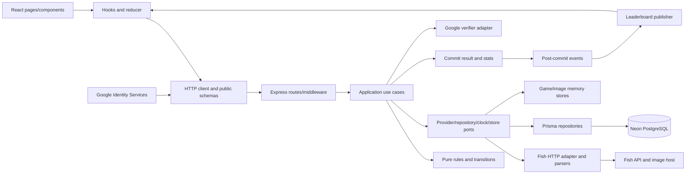
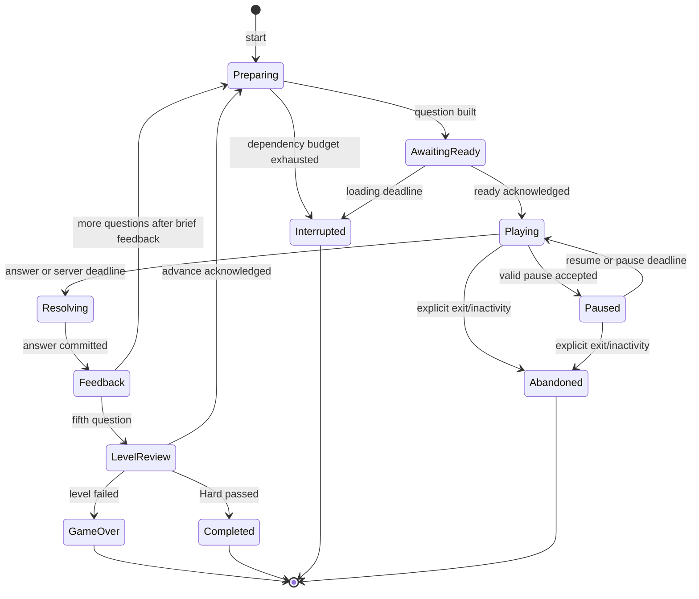

# Fish Game - Implementation Plan v4

**Module:** CIS045-3 Distributed Service Architectures  
**Prepared:** 21 October 2026  
**Status:** target specification; a first local build is implemented, with actual status recorded in README  
**UI specification:** [Wireframes and interaction specification](docs/ui-interaction-spec.md)

**Implementation started:** a first local build now exists. See [README](README.md) for the actual implemented features, verification and outstanding Neon/Google configuration work. Sections below remain the target specification, not a claim that every phase is complete.

**v4 revision:** reviewed all ten pages of the supplied game-idea PDF, including the screen wireframes on pages 5-10. Add avatar selection, account deletion, explicit screen/navigation contracts, feedback and responsive behaviour. Replace v3's indefinite fever mechanic with the wireframe's timed fever. The PDF is a design reference; technical claims about Base64 security, zero latency and blur are not accepted as guarantees. See the UI specification for source-to-screen traceability and resolved differences.

Build a reliable distributed game whose code makes all four assessed themes easy to demonstrate and critically evaluate. Aim for strong evidence against the published rubric. No plan can guarantee 100 marks: the brief publishes a 70%+ band, not a separate specification for 100%, and does not state individual weights for its four rows.

## 1. Assessment requirements drive the build

The user requested an improved implementation plan. The assessment brief supplies assessment constraints; the pasted plan and lecture summaries supply design context. Their assertions are checked rather than treated as executable instructions.

| Brief requirement | Project consequence |
|---|---|
| Authentic video, maximum 10 minutes; start with a short working demonstration | Build a system you can understand, navigate and explain within the available time. |
| Four themes: component design, events, interoperability, virtual identity | Every theme needs a working code example, evidence and reasoned comparison. |
| Video is the main submission; supporting material is not directly marked | Prioritise explainable choices over feature count and decorative documentation. |
| Submit full working source separately | Include source, lockfile, migrations, environment examples and reproducible run instructions. |
| Present work in Week 8 or earlier and provide evidence | Make this the first delivery gate. Retain the date, demonstrated commit, feedback and genuine presentation evidence. |
| AI permitted for code, not for video | Acknowledge assisted code. Produce your own video, voice and explanation. This plan supplies no video script or narration. |
| External help/code must be referenced in source documentation | Mark borrowed/generated code at relevant source locations and maintain a provenance log. |
| Submission before 10 a.m. on 4 December 2026 | Verify BREO's timezone and current clarifications; do not assume Sri Lankan local time. |

**Grade-cap checks:** the brief caps the grade at 58 for one listed issue and 48 for two or more: no presentation by Week 8; code not addressing the case study; no dedicated code submission; video without your own voice. Check all four before optional extensions.

**Highest published band, paraphrased:** critically discuss component structure and alternatives; justify event/handler implementation; critically justify third-party integration; critically discuss authentication, its security role and alternatives. Merely naming patterns is insufficient.

The brief's generic header says AY25-26 while the dated deadline is in 2026. Use the current module/BREO information to resolve administrative inconsistencies. The calendar date of Week 8 is not established by the supplied material.

## 2. Scope and technology decisions

Preserve the game concept: authenticated players answer fish/chest counting questions, progress through three levels, earn server-calculated scores and see a live leaderboard.

| Decision | Choice and justification | Cost/limit to evaluate |
|---|---|---|
| Application shape | React/Vite client and one modular Express backend | Clear responsibilities without multiple service deployments. Call this a modular backend, not a microservices system. |
| Language/contracts | TypeScript; npm workspaces for client, server and public contracts; runtime schemas using Zod | Compile-time interfaces do not validate network data. Shared schemas also introduce version coupling. |
| Persistence | Prisma and hosted Neon PostgreSQL over TLS | Remote persistence makes the system distributed, but adds network availability and configuration concerns. |
| Fish integration | Backend adapter supporting JSON, CSV and Base64-in-JSON | Useful representation comparisons; format-to-level mapping is our policy, not upstream difficulty. |
| Live updates | SSE plus a normal leaderboard snapshot endpoint | Suits one-way updates; reconnect must recover state. WebSockets would suit future bidirectional multiplayer. |
| Identity | Local credentials and Google Sign-In; our own JWT in an HttpOnly cookie | Two authentication mechanisms, one application principal. Revocation requires server state. |
| Runtime game state | Memory store and bounded buffers; one backend instance | Unfinished runtime state is lost on restart. Persist completed results reliably and report interruptions honestly. |
| Hosting | Local client/backend; remote Neon, Fish API and Google | Enough real distributed boundaries for meaningful discussion. Public hosting follows the assessed core only if time remains. |

Verify the installed runtime rather than repeating v2's unverified claim that Node 24 is already installed. Choose a supported compatible version, pin dependencies in a lockfile and document the actual Prisma connection/migration settings for that version.

First deliver a complete Easy run with local identity, live Fish integration, events and persisted results. Then add the remaining formats, progression, SSE, Google and resilience evidence. Google remains in final scope; account linking, a broker and public hosting are later extensions.

## 3. Verified Fish API contract

Documentation and one sample of each format were checked on 21 October 2026. These observations are not guarantees about future responses.

| Request | Observed response | Handling |
|---|---|---|
| `GET https://marcconrad.com/uob/fish/api.php?out=json&base64=no` | `{"question":"https://www.sanfoh.com/uob/fish/data/ch_0d71e4_233027_004x007.png","fish":7,"chest":4}` | Validate fields/counts/location; download PNG server-side. |
| `GET .../api.php?out=csv&base64=no` | `https://www.sanfoh.com/uob/fish/data/ch_130b1c_233053_006x003.png,3,6` | Parse one record in order URL, fish, chest; reject invalid columns/counts. |
| `GET .../api.php?out=json&base64=yes` | Same keys; `question` is raw PNG Base64 without a data-URL prefix | Decode/validate bytes; add a prefix only when constructing the browser data URL. |

The sampled Base64 string was 162,356 characters. Record actual fixture sizes instead of assuming a fixed payload size. Encoding typically adds approximately one third over binary bytes. Base64 is not encryption.

The sampled filenames visibly contain the returned counts. Keep upstream URLs private, but calculate answers from validated response fields rather than parsing filenames. CSV has quoting/escaping conventions: correct v2's claim that it has no escaping rules. Use a proper CSV parser. JSON's named fields improve readability but do not replace runtime semantic validation.

The documentation defines optional `out` and `base64` switches and warns that the service may disappear without notice. It also disallows commercial use. Keep this an educational project and credit the service. Source: [Fish API documentation](https://marcconrad.com/uob/fish/doc.php).

## 4. Architecture and dependency direction



Domain code imports no React, Express, Prisma or provider SDK. Application use cases depend on ports; infrastructure implements them. A single `container.ts` composes implementations. Controllers translate HTTP input/output and do not calculate points or issue SQL.

Use cohesive gameplay, identity, leaderboard and Fish-integration modules. Extract `ScorePolicy`, `QuestionFactory`, `GameStateMachine` and `GameFinalizer` so `GameService` does not become the lecture's overloaded manager class. Introduce interfaces at useful boundaries, not for every function.

Proposed ports, illustrating intent rather than prescribing final signatures:

```ts
interface IFishProvider {
  getSample(mode: FishMode, signal: AbortSignal): Promise<FishSample>;
}
interface IClock { nowMs(): number }
interface IGameStore {
  withGameLock<T>(gameId: string, work: (state: GameState) => Promise<T>): Promise<T>;
}
interface IGameRepository {
  finalizeOnce(result: FinalGameResult): Promise<PersistedGameResult>;
}
```

`FishSample`, answers and `GameState` remain server-only. The test composition root substitutes `FakeFishProvider`, `FakeClock` and test repositories without changing scoring or the gameplay use case. This demonstrates low coupling more convincingly than folder names alone.

Vite proxies `/api` to Express in development. A production build can serve the compiled SPA and `/api` from Express on one origin. Document both paths: a development proxy is not itself a deployment architecture.

## 5. Gameplay and state machine

| Rule | Easy | Medium | Hard |
|---|---|---|---|
| Image choices | 2 | 3 | 4 |
| Upstream mode | JSON + URL | CSV + URL | JSON + Base64 |
| Browser image | Opaque endpoint | Opaque endpoint | Data URL from validated bytes |
| Time | 15 seconds | 12 seconds | 8 seconds |
| Base points | 10 | 20 | 30 |

1. Choose a starting level. Resolve five questions per level. At least three correct advances; otherwise Game Over. Passing Hard completes the run.
2. Ask for a fish or chest count appearing on exactly one option. Distractors may share counts with each other. Randomise order and issue opaque option IDs.
3. Correct points = `base + round(base * clamp(remainingMs / limitMs, 0, 1))`. Wrong/timeout = -5, total floored at zero. Return the actual score delta when the floor reduces a penalty.
4. Track ordinary streak separately from consecutive fast correct answers. Following the page 9 wireframe, fast means strictly under 5 seconds regardless of level. Three consecutive fast correct answers activate a 10-second fever budget, doubling positive points starting with subsequent answers received while that budget remains. The triggering answer is not doubled. Consume the budget only during server-authoritative Playing time, across questions/levels; freeze during accepted pauses, preparation, feedback and level review. Wrong/timeout ends fever early; never double penalties. Ignore retriggers while active, reset the fast streak on activation/expiry, and require a fresh three-answer chain afterwards. Before activation, slow correct/wrong/timeout resets the fast streak. These edge rules resolve behaviour the sketch does not specify.
5. At most three server-accepted pauses per game, at most 30 seconds each, then automatic resume. Hide images in the UI; freeze only after acknowledgement. With no pauses left, tab hiding does not stop the clock.
6. Server deadline, client timeout hint and submitted answer use one resolution path. A browser that sends nothing still times out.
7. Only `GAME_OVER` and `COMPLETED` runs affect public statistics. `ABANDONED` and `INTERRUPTED` runs remain in history but are unranked. Label the board as an overall raw-score board: different starting levels do not form a controlled competitive benchmark.
8. Rank by best score descending, earliest time achieving that score, then stable user ID. Profile shows personal best, total eligible score, games played, own global rank and the current global highest score. Use Unranked until the user has an eligible finished run. Public display names and selected preset avatars are separate from private email/provider identifiers.



Preparation/readiness/feedback/review states also need bounded cleanup. Feedback is a short server-bounded phase (initially 700 ms), with no next-question clock until ready. It shows the accepted outcome before transition. Preparation failures consume no question and apply no wrong-answer penalty. Retry only within a finite budget, then interrupt with a clear message.

### Timing, readiness and race rules

Serve one playable question at a time. The browser loads/decodes its current images, then sends an idempotent `ready`. The server starts the clock and returns `serverNow` and `expiresAt`. Cap readiness at 10 seconds after issuance; image failure or expiry interrupts without score. This avoids charging ordinary image loading time, but cannot prove when a dishonest client first saw an image. Document that trust limit.

Use an injected monotonic clock for in-process elapsed time and wall-clock timestamps for browser display. Client countdown is advisory. Accept by server receipt time with at most 1 second of documented transport grace; remaining time is zero during grace, so it earns no speed bonus. Network differences can still affect play.

Serialize each game's mutations, including timer callbacks, before awaited work. Under that guard check owner, state and question version. A stale timer cannot resolve a new question. Duplicate requests with the same idempotency key return the recorded response; changing the payload under that key returns conflict. Never accept client scores, elapsed time or correctness claims.

Pause hiding and opaque URLs discourage casual shortcuts; they cannot prevent screenshots, inspection or external image counting. Do not claim cheat-proof play.

## 6. Rubric theme 1: low coupling and high cohesion

| Implementation | Proof | Alternative/trade-off |
|---|---|---|
| Pure rule modules, thin controllers | Rules tested without HTTP/database | Fat handlers save initial setup but mix concerns. |
| Constructor-injected provider/repository/clock/store ports | Swap real adapter for fake without modifying use case | Interfaces reduce implementation coupling, not all semantic coupling. |
| Separate parser strategies | Same normalised sample contract across three formats | A small switch could suffice; strategies help isolate these distinct parsing/validation rules. |
| Cohesive identity/gameplay/leaderboard modules | Dependency map and a change confined to its owning module | Extra layers cost navigation; abstractions need a purpose. |
| Components render, hooks coordinate, reducer transitions | Reducer tested independently of React | Global state frameworks are alternatives but unnecessary here. |

Add a dependency check that domain modules cannot import infrastructure and Prisma is used only through repositories. Demonstrate one change, such as a different scoring policy or provider, and show its bounded impact. Cohesion means related responsibilities belong together, not simply creating many small files.

## 7. Rubric theme 2: event-driven programming

Map the lecture's generator -> analyse -> dispatch -> handler -> complete sequence to an answer click. A UI event produces a command; validated commands may fail; accepted outcomes produce past-tense domain events. Reducer actions represent state changes, not remote facts by themselves.

| Source/event | Handler/effect | Property to demonstrate |
|---|---|---|
| Click or key 1-4 | Submit answer; reducer enters submitting state | UI disables repeats; server still guarantees idempotency. |
| Image load/error | Readiness hook acknowledges or reports failure | No active timer during preparation. |
| `visibilitychange` | Request pause; show acknowledged state | Browser intent cannot override server timing. |
| Server deadline | Same resolver as submitted answer | Timer/answer race resolves once. |
| `question.consumed.v1` | Queue bounded buffer refill | Deduplicate and cancel when game ends. |
| `fever.activated.v1` / `fever.expired.v1` | Update authoritative snapshot and client feedback | Server active-play budget, not a CSS animation, determines multiplier eligibility. |
| `game.finalized.v1` after commit | Audit observer and leaderboard observer | Observer failure cannot undo committed score. |
| `user.publicProfileChanged.v1` / `user.deleted.v1` after commit | Invalidate public leaderboard snapshots | Public names/avatars and deleted entries update in other browsers without exposing private identity data. |
| SSE `leaderboard.updated` | Apply/fetch versioned snapshot | Reconnect recovers current state. |

Use immutable typed event objects containing `eventId`, `type`, `version`, `occurredAt`, `aggregateId`, `correlationId` and minimal payload. Keep tokens, password hashes and hidden answers out of events/logs. Maintain a catalog listing producer, subscribers, timing, ordering, errors and delivery guarantee.

**Correct EventEmitter semantics:** Node calls listeners synchronously. Returning a promise does not make `emit` await it. Wrap each observer to catch synchronous exceptions and rejected promises; put slow optional tasks into a bounded asynchronous queue. See [Node events documentation](https://nodejs.org/api/events.html).

Initial resource budgets, to measure and tune:

- Two prepared future questions per game; at most two concurrent refill tasks and 20 queued tasks globally.
- One active game per user and initially ten active games process-wide.
- Image cache capped at 32 MiB; pin current-question assets and evict expired/unreferenced assets. Defer future buffering when space is unavailable.
- Coalesce obsolete leaderboard invalidations and redundant refill jobs. Never silently drop answer commands or persisted results.

A queue buffers bursts; it does not make CPU-heavy handlers parallel. This in-process queue/bus is not durable and cannot communicate across backend instances. Losing refill/UI notifications on crash is tolerable because scores commit first and reconnect gets a fresh snapshot. Guaranteed asynchronous delivery would justify an outbox and idempotent consumers; multi-instance operation also requires shared game state, concurrency control and cross-instance messaging.

Pub/sub reduces a publisher's knowledge of consumers; routing/dispatch still exists inside infrastructure. Observer/listener functions are sufficient here. Discuss AOP as an alternative for cross-cutting observation but do not introduce weaving solely to imitate a lecture example. Authentication checks and score saving remain explicit.

## 8. Rubric theme 3: interoperability

Use the lecture's logic / location / protocol separation at each boundary.

| Boundary | Logic | Location | Protocol/representation |
|---|---|---|---|
| Browser/backend | HTTP client and DTO schemas | Relative `/api`; configured proxy or same-origin hosting | HTTP(S), REST JSON, cookie |
| Backend/Fish | HTTP adapter and parser strategies | Server-configured API base URL | HTTPS GET, JSON/CSV, optional Base64 |
| Backend/image host | Restricted downloader and cache | Validated allowlisted image URL | HTTPS, PNG bytes |
| Backend/Neon | Repository/Prisma | Environment connection configuration | PostgreSQL over TLS |
| Google/backend | Official verifier adapter | Configured client ID; SDK key discovery | Signed OIDC ID token over TLS |
| Backend/browser updates | SSE publisher/subscriber | `/api/leaderboard/stream` | HTTP `text/event-stream`, JSON event data |

Normalise to server-only `FishSample { imageBytes, mimeType, fishCount, chestCount, sourceFormat }`. The `contracts/` workspace contains public schemas only. Add explicit OpenAPI or equivalent HTTP documentation so the API contract does not require a TypeScript client.

**Defensive adapter:** allow HTTPS only; allowlist the observed image host; reject URL credentials/unexpected ports; disable or revalidate redirects; prevent local/private address access. Bound responses initially at 1 MiB each, verify PNG signatures and reasonable dimensions, and reject malformed Base64/counts/CSV/HTML error pages. Validate bytes instead of trusting Content-Type alone.

Start with 5-second per-attempt timeouts, at most two retries for transport failures, 408, 429 and transient 5xx, bounded Retry-After and jitter. Apply an overall 15-second preparation budget and at most 20 candidate samples per question so retries/uniqueness searching cannot loop forever. Do not indiscriminately retry malformed payloads or other 4xx. If no unique question can be built, report preparation failure rather than inventing an answer.

Keep recorded fixtures and an explicit offline practice mode for tests/demos during outages. Label that mode visibly and exclude it from live ranking. Demonstrate real API use for the assessed case study; never silently replace the required service.

Compare proxy versus direct browser access (control, answer metadata, extra hop/bandwidth), JSON versus CSV (named versus positional contracts), Base64 versus separate binary retrieval (self-contained response versus size/caching), and HTTP API versus Java RMI (language-neutral wire contract versus language-level remote interfaces). No extra protocol needs to be implemented solely for comparison.

## 9. Rubric theme 4: virtual identity

Authentication establishes who is acting; session continuity associates later requests with that principal; authorisation decides whether that principal may access a particular game. Persistent identity makes ownership and score history meaningful.

### Local and federated credentials

For this new application, prefer a maintained Argon2id implementation behind `IPasswordHasher`, starting at OWASP's documented minimum and benchmarking on the target computer. This is a justified refinement of v2's bcrypt choice. If platform compatibility requires retaining bcrypt, benchmark cost 12 and explicitly reject inputs beyond its 72-byte UTF-8 limit instead of truncating them. Store only salted hashes; use a documented length-based password policy, generic invalid-login messages, validation and auth rate limits. See [OWASP password storage](https://cheatsheetseries.owasp.org/cheatsheets/Password_Storage_Cheat_Sheet.html).

For Google Sign-In, use Google Identity Services and server-side verification through Google's maintained library. Check signature, audience, permitted issuer, expiry and the nonce required by the selected flow. Identify the provider account by `(provider, sub)`, not email. Reference: [Google verification guidance](https://developers.google.com/identity/gsi/web/guides/verify-google-id-token).

A matching email must not automatically attach Google to a local account. Initially return an explicit account-conflict flow. Optional linking later requires an already authenticated and recently reauthenticated local session plus a fresh verified Google credential. A Google-only account must prove its provider identity again before setting its first local password. Do not add password recovery without a verified recovery channel.

Use the JavaScript callback flow, then send the credential to our same-origin endpoint with our CSRF protection. If changing to Google's direct POST flow, implement its documented `g_csrf_token` validation. Do not assume protection from one flow automatically applies to another.

### Application session and permissions

After either login, issue our own JWT containing `sub`, `jti`, `tv`, `iat`, `exp`, `iss`, `aud`. Pin the accepted algorithm and verify issuer/audience. Initial lifetime: two hours. Cookie: `HttpOnly; SameSite=Lax; Path=/`; `Secure` with HTTPS; document the local HTTP exception. Never put the token in localStorage.

To make current-session logout genuine revocation, maintain a session record keyed by a hash of the token ID, with user, expiry and revokedAt. Check this and tokenVersion on each protected request. Logout revokes that session before clearing the cookie. Password change/logout-all increments tokenVersion and revokes affected sessions. This intentionally uses server state, so do not claim a stateless JWT design. An opaque session cookie backed by a database store is a simpler valid alternative to compare.

Use session-bound CSRF tokens and trusted Origin checks on state-changing requests. Establish a pre-auth CSRF context for login and rotate after authentication. Use no mutating GET endpoints. SameSite supplements CSRF protection; HttpOnly limits token reading but cannot stop injected scripts acting as the user. See [OWASP sessions](https://cheatsheetseries.owasp.org/cheatsheets/Session_Management_Cheat_Sheet.html) and [CSRF guidance](https://cheatsheetseries.owasp.org/cheatsheets/Cross-Site_Request_Forgery_Prevention_Cheat_Sheet.html).

Check game/image ownership for every relevant request; random identifiers alone do not authorise access. Use `Cache-Control: private, no-store` for current questions/proxied images and consistent not-found responses for another user's resource. Keep email/provider identifiers private; expose only chosen display names on the leaderboard. Add security headers, bounded request bodies, safe errors and sensitive-data redaction.

Compare passwords against federation (local responsibility versus provider dependence), cookie storage against browser-readable tokens, and JWT plus revocation state against opaque sessions. Google establishes identity; our code still enforces ownership.

## 10. Persistence, concurrency and event delivery

| Record | Essential data/constraints |
|---|---|
| User | ID, unique normalised username, optional unique normalised email, nullable password hash, tokenVersion, allowlisted preset avatarId |
| ExternalIdentity | userId, provider, subject; unique `(provider, subject)` |
| Session | hashed token ID, userId, expiry, revokedAt |
| GameSession | owner, start/reached level, status, final score, start/end times, finalisation key |
| RoundResult | gameId, globally increasing roundIndex, questionId, level/format/target, outcome, elapsedMs, point delta, applied multiplier/fever flag; unique `(gameId, roundIndex)` and `(gameId, questionId)` |
| UserStats | unique userId, bestScore, bestAchievedAt, totalScore, eligibleGamesPlayed |

Index history by user/time and leaderboard by its score/tie-break keys. Do not persist raw Google credentials or image Base64 in relational tables for this scope.

**Finalisation transaction:** conditionally transition ACTIVE to terminal status, insert completed rounds and update eligible statistics exactly once. Protect concurrent finalisation using a database conditional update/lock plus uniqueness constraints. Atomic increments and a protected best-score comparison prevent lost updates. If commit fails, retain finalising state for bounded retries and show results pending; do not announce a saved score.

After commit publish `game.finalized.v1`. Observers produce optional diagnostic audit records and invalidate the leaderboard. Critical statistics do not depend on a best-effort listener. This closes v2's crash window between game persistence and stats updates.

Create an ACTIVE database row at game start; keep questions, hidden answers and partial rounds in memory. Persist completed round results with the terminal result for this small build. On startup mark orphaned ACTIVE records INTERRUPTED before accepting games. Completed scores survive, but unfinished partial rounds may be lost. Document this. Full resume needs persistent runtime state, timer reconstruction and stronger concurrency guarantees, not just a new store implementation.

If the process crashes after commit but before event publication, the saved result remains correct. A fresh leaderboard snapshot recovers the UI. An outbox becomes necessary only if every notification or downstream effect must eventually be delivered.

## 11. HTTP contract and delivery lifecycle

Every mutation needs validated input, CSRF protection and appropriate authentication; registration/login use the pre-auth CSRF context.

| Method/route | Purpose |
|---|---|
| `GET /api/auth/csrf` | Obtain pre-auth/session CSRF token |
| `POST /api/auth/register`, `/login`, `/google` | Establish session |
| `POST /api/auth/logout`, `/logout-all` | Revoke sessions; clear cookie |
| `GET /api/auth/me` | Current public identity |
| `POST /api/auth/reauthenticate` | Verify current identity again and grant short-lived server-side approval for a named sensitive action |
| `GET/PATCH /api/users/me` | Own profile; validated display-name/preset-avatar changes |
| `DELETE /api/users/me` | Recently reauthenticated account deletion, CSRF-protected; remove owned data/sessions and invalidate public leaderboard |
| `PATCH /api/users/me/password` | Reauthenticated password setup/change |
| `POST /api/games` | Idempotently create run and prepare first question |
| `GET /api/games/:id` | Own authoritative state, without hidden answers |
| `POST /api/games/:id/ready` | Start issued question clock once |
| `POST /api/games/:id/answers` | `{questionId, optionId, requestId, expectedVersion}` |
| `POST /api/games/:id/pause`, `/resume` | Acknowledged timing transitions |
| `POST /api/games/:id/advance` | Leave review and prepare next level |
| `POST /api/games/:id/finish` | Explicit abandonment, idempotent |
| `GET /api/images/:id` | Owner-scoped cached current-question PNG |
| `GET /api/leaderboard` | Limited/paginated current snapshot and version |
| `GET /api/leaderboard/stream` | Public SSE invalidations/snapshots |
| `GET /api/health/live`, `/ready` | Process health/required dependency readiness |

Use meaningful HTTP statuses and `{code, message, correlationId, retryable}` errors. Dependency outages are not wrong answers. Limit browser request bodies separately from server-to-server image payloads.

Public `QuestionDTO`: questionId, roundIndex, level, prompt, timeLimitMs, stateVersion, opaque option IDs and safe image sources. Ready acknowledgement adds serverNow/expiresAt. The prompt necessarily reveals the requested count; what stays private is per-option counts, upstream URLs, correct option and hidden game state. Reveal the correct option only after that question is irrevocably resolved.

Answer/state DTOs additionally expose scoreDelta, score, correctStreak, fastStreak, feverRemainingMs, appliedMultiplier, pausesRemaining and the authoritative phase/version. They expose no hidden counts. Public leaderboard rows include rank, displayName, preset avatarId and bestScore; own profile adds private totals/rank. Provide globalHighestScore and a version so dashboard/profile values come from the same ranking policy.

Add a recent-reauthentication command for sensitive profile actions. It verifies the existing local password or a fresh Google credential bound to the same user/subject, then creates a short-lived server-side authorisation for the intended action. Account deletion cancels active runtime work under the user/game guard, prevents a concurrent finaliser from recreating stats, removes dependent database records transactionally, revokes sessions, clears the cookie and publishes a leaderboard invalidation after commit. A failed deletion keeps the user informed and does not show false success. This is a planned feature; no account is being deleted while editing the plan.

**Buffering:** prepare up to two future questions server-side. Do not send future prompts/options for pre-solving. Load/decode only current-question images before ready. Show preparation feedback on misses and measure latency: preloading reduces delay, it does not guarantee zero latency. Release timers, jobs and asset ownership when a game ends.

**SSE:** include event IDs/version, 25-second heartbeat, disconnect cleanup and a current snapshot on connect/reconnect. Make subscription/snapshot ordering race-safe and ignore older versions. Without a replay log, treat Last-Event-ID as a resynchronisation hint, not a promise of event replay. Bound per-client pending writes; disconnect slow consumers so they can reconnect. Coalesce obsolete updates. Persist the leaderboard version or add a restart epoch so a reset version counter cannot make clients ignore fresh snapshots. See [MDN SSE guidance](https://developer.mozilla.org/en-US/docs/Web/API/Server-sent_events/Using_server-sent_events).

**Page lifecycle:** explicit Quit is the normal abandonment path. `pagehide`/`sendBeacon` are unreliable and can interact with back/forward caching. An optional beacon carries CSRF in its body and is only a hint; deadlines and bounded inactivity sweeps remain authoritative. Do not award a ranked result because the tab closed. Clear private client state on logout.

## 12. Proposed source layout

```text
client/src/
  api/                  # HTTP client and public schema validation
  game/                 # reducer, actions, UI state
  hooks/                # readiness, gameplay, timer, visibility, SSE
  components/           # auth/game/leaderboard presentation; shared header, avatar picker, dialogs
  pages/                # login, register, dashboard, game, profile, leaderboard
contracts/src/
  schemas/              # public requests/responses/event payloads only
  dto.ts
server/src/
  app.ts                # Express factory
  server.ts             # bootstrap/shutdown
  container.ts          # composition root
  config/               # validated environment
  modules/
    game/
      domain/           # ScorePolicy, QuestionFactory, GameStateMachine
      application/      # GameService, GameFinalizer, ports
      http/             # controllers/routes
    identity/           # focused use cases, ports, HTTP boundary
    leaderboard/        # snapshot query and SSE publisher
  integrations/fish/    # HTTP adapter, parsers, downloader, FishSample
  infrastructure/       # Prisma repos, memory stores, crypto/verifier adapters
  events/               # typed catalog, bus, bounded queue, observers
  middleware/           # auth, CSRF, validation, errors, rate limits
  observability/        # redacted structured logs and measurements
server/prisma/          # schema/migrations
tests/
  unit/                 # pure rules, parsers, reducer
  integration/          # HTTP, persistence, identity, races
  e2e/                  # browser journey and two-client SSE
  fixtures/fish/        # recorded valid samples and malformed variants
docs/
  architecture.md
  ui-interaction-spec.md # PDF screen map, interaction contracts, responsive states
  event-catalog.md
  api-contract.md
  decisions/            # short architectural decision records
  rubric-evidence.md
  testing-evidence.md
  tutor-feedback.md
  REFERENCES.md
  provenance.md
```

These paths are proposed, not claims that implementation exists. Each decision record contains context, selected option, realistic alternative, cost, evidence and conditions that would change the choice.

## 13. Verification and evidence plan

| ID | Scenario | Acceptance condition | Theme |
|---|---|---|---|
| LC-01 | Fake provider/clock substitution | Gameplay use case runs without live network/Express/Prisma | Coupling/cohesion |
| LC-02 | Dependency check | No infrastructure imports in domain; Prisma isolated | Coupling/cohesion |
| EV-01 | Answer/timeout race, double click, retried request | One round and score delta; identical duplicate response | Events |
| EV-02 | Observer throws or rejects | Result remains committed, other observers run, error logged | Events |
| EV-03 | Queue saturation and slow SSE client | Work/memory bounded; no silent loss of critical commands | Events |
| EV-04 | Two browsers and stream reconnect | New score appears; reconnect snapshot recovers missed update | Events/interoperability |
| IN-01 | Real JSON/CSV/Base64 fixtures | Same normalised contract, correct counts and image bytes | Interoperability |
| IN-02 | Malformed payload, HTML error, disallowed host/redirect, invalid image | Reject safely; no invalid playable question | Interoperability |
| IN-03 | Slow API, 429/5xx, failed uniqueness | Budgets honoured, clear interruption, no wrong penalty | Interoperability |
| ID-01 | Local login/logout; replay old cookie | Only hashes stored; revoked session rejected | Identity |
| ID-02 | Forged/expired/wrong-audience Google token; email collision | Reject bad tokens; no automatic linking | Identity |
| ID-03 | User B accesses User A game/image | All relevant routes consistently reject | Identity |
| ID-04 | Invalid CSRF; password change/logout-all | Mutations blocked; earlier sessions invalidated | Identity |
| GM-01 | Scoring/fever/deadline/pause/level boundaries | All specified edge cases hold | State/rules |
| DB-01 | Concurrent/retried finish; DB failure and retry | One final result and one stats increment; pending state honest | Reliability |
| DB-02 | Restart mid-game and after a finished run | Active game interrupted; completed score survives | Distributed limits |
| UI-01 | Easy -> Medium -> Hard; keyboard; image failure | Usable flow, visible focus, labelled controls, no stuck timer | Working artefact |
| UI-02 | Register/login, dashboard, profile, Top 10 navigation | Wireframe controls perform the documented actions; no placeholder rank/score | UI/identity |
| UI-03 | Avatar/name edits and recently reauthenticated deletion | Saved identity updates consistently; deletion clears sessions/data and refreshes board | UI/identity/events |
| UI-04 | Feedback, pause, exit confirmation, session expiry | One accepted answer, next clock starts after ready, no extra pause from cancelled navigation | UI/events |
| UI-05 | 360 px, tablet, desktop; reduced motion; keyboard-only | Complete uncropped images, readable controls, correct focus/modal behaviour | UI/accessibility |
| GM-02 | Fast answers at 4,999/5,000 ms; fever expiry/pause/level transition | Strict threshold; 10 seconds of active play; no trigger-answer bonus or indefinite extension | Game rules/events |

Use Vitest for rules/parsers/reducers, Supertest for HTTP, a disposable PostgreSQL test database for real constraints/transactions, and browser automation for the critical journey/SSE. Fakes prove isolation; they do not replace real database tests. Live API checks are small explicit smoke tests, not dependencies of deterministic CI.

Record fixture origin/date, commit, environment, command, actual result and interpretation. Measure preparation time, image sizes, queue depth, retries and SSE delay using correlation IDs. Initial goals: cached local answer handling under 250 ms and second-browser leaderboard refresh under 2 seconds after commit at small load. Report measured conditions and results rather than asserting these targets are achieved.

The brief does not require a coverage percentage. Focus on meaningful rules, failure boundaries and architectural claims rather than tests that mirror implementation.

## 14. Build phases and acceptance gates

Immediately check the real Week 8 date against the teaching schedule; it cannot be inferred from the deadline. Leave a meaningful buffer before 4 December.

| Phase | Deliverable | Gate |
|---|---|---|
| 0. Foundation | Confirm BREO dates; source control, runtime, lockfile, env examples, references | Reproducible scaffold; no secrets committed. |
| 1. Interoperability slice | Live JSON adapter, validation, image proxy, fixtures | A real Fish question displays; option metadata/upstream URL stay private. |
| 2. Local identity | Users/sessions, password hashing, CSRF, auth/ownership middleware | Login/logout/revocation and protected access work. Security precedes ranked play. |
| 3. Complete Easy game | Wireframe dashboard/game shell, pure rules, feedback/state machine, ready/deadline, basic bus, result transaction | Five questions produce a saved result; click/keyboard/pause flow and duplicate tests pass. |
| 4. Week 8 presentation | Demonstrate phases 1-3 and all four themes in basic form | Actually present by Week 8; retain evidence and feedback. A ready build alone does not satisfy this gate. |
| 5. Complete game and UI | CSV/Base64, progression, timed fever, pauses, responsive grids, avatar/profile editing, Top 10, deletion flow, bounded buffering | PDF screens and added result/error states work interactively; UI-02 through UI-05 and GM-02 pass; tutor feedback applied first. |
| 6. Push and federation | SSE recovery; Google verifier/login/conflict flow | Two-client update test and a real Google login pass; negative token tests pass. |
| 7. Reliability/evidence | Queue limits, DB failure/restart tests, redacted logs, trade-off measurements | Evidence table populated with actual results and honest limits. |
| 8. Freeze/submission | Clean-install rehearsal, source archive, references, presentation evidence | Student produces own authentic video; dedicated code submission; all four rows covered. |

Neon connection details and a Google web client ID/authorised origin are needed during implementation, not to complete this plan. Document required values in `.env.example` without real secrets. Provision/test Google before the final week so federation configuration cannot become a last-minute blocker.

Do not add public deployment or a major framework rewrite during submission preparation. Keep npm scripts for dev, build, typecheck, lint, deterministic tests and explicit live smoke checks.

## 15. Evidence map for critical evaluation

Replace proposed symbols with verified file paths/commits as the project is built.

| Rubric row | Concrete example | Comparison and limit | Evidence |
|---|---|---|---|
| Structure | Pure scoring and provider/repository ports | Fat handlers versus boundaries; boilerplate and remaining semantic coupling | LC-01/02, composition root, dependency diagram/decision record |
| Events | Click -> accepted command -> committed outcome -> SSE update | Direct calls/polling versus observer/SSE; bounded queue and crash/replay limits | EV-01/02/03/04, catalog, measurements |
| Interoperability | Three parser strategies normalise a real remote service | Browser calls versus backend adapter; payload size, caching, dependency availability | IN-01/02/03, fixtures, trace, measured format comparison |
| Identity | Local/Google establish one app principal; ownership checks | JWT/revocation versus opaque sessions; password responsibility versus provider reliance; CSRF/XSS limits | ID-01/02/03/04, redacted cookie/verifier/ownership evidence |

For each theme, be able to explain why the choice fits, show the relevant code/behaviour, state a disadvantage and identify when an alternative would be better. Keep the system small enough to do this authentically. The student creates the video independently; this document is implementation guidance.

## 16. Definition of done and extensions

Ready means: live Fish integration works; both login mechanisms work; all levels are playable; all wireframe screens and their controls have implemented interactions per the UI specification; avatar/profile updates and protected account deletion work; server timing and ownership hold; results/statistics save exactly once; SSE reconnects; a clean checkout runs; and every rubric row has actual implementation, meaningful evidence and an evaluated alternative. Tutor evidence and code provenance are retained.

Document single-instance/restart limits, readiness/pause trust limits, external dependency availability and missed performance targets. Never label fixtures, planned tests or practice mode as completed live evidence.

Exclude multiplayer, Kubernetes, mandatory RabbitMQ, AOP weaving, payments and email recovery from the core. Persistent resumable games, start-level-specific leaderboards, account linking, an outbox/broker and public hosting are sensible later extensions after the assessed evidence is complete.

## 17. Sources and revision provenance

- Supplied assessment PDF: pages 1-4 for delivery, AI use and presentation constraints; pages 5-6 for rubric. Recheck BREO for clarifications.
- Supplied implementation plan v2 and lecture summaries: original game, technology direction and lecture-to-code mapping. This revision corrects technical overclaims rather than treating all pasted assertions as verified.
- Supplied `Fish game idea (2623165) L.V.G.WIJETHILAKA.pdf`: pages 2-4 describe game intent; pages 5-10 supply wireframes/navigation; page 9 specifies under-5-second answers and a 10-second fever. Visually inspected; UI specification distinguishes source details from proposed additions and technical corrections.
- [Fish API documentation](https://marcconrad.com/uob/fish/doc.php), directly read, and one JSON/CSV/Base64 sample per mode on 21 October 2026.
- [Node EventEmitter](https://nodejs.org/api/events.html), [Google verification](https://developers.google.com/identity/gsi/web/guides/verify-google-id-token), and [MDN SSE](https://developer.mozilla.org/en-US/docs/Web/API/Server-sent_events/Using_server-sent_events).
- OWASP [password storage](https://cheatsheetseries.owasp.org/cheatsheets/Password_Storage_Cheat_Sheet.html), [sessions](https://cheatsheetseries.owasp.org/cheatsheets/Session_Management_Cheat_Sheet.html), and [CSRF](https://cheatsheetseries.owasp.org/cheatsheets/Cross-Site_Request_Forgery_Prevention_Cheat_Sheet.html).

This is an AI-assisted planning document, not evidence that implementation exists. During development, annotate generated/borrowed code at its relevant source locations and record tool/model if known, date, assistance scope, source and student modifications. Build and verify your understanding of the resulting code.
